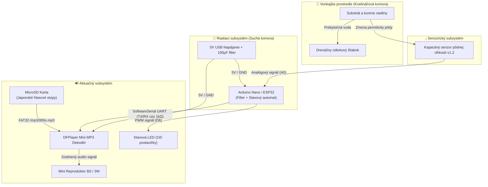
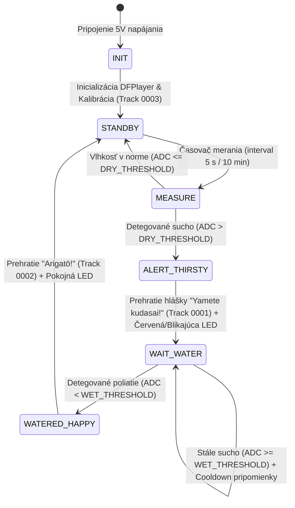
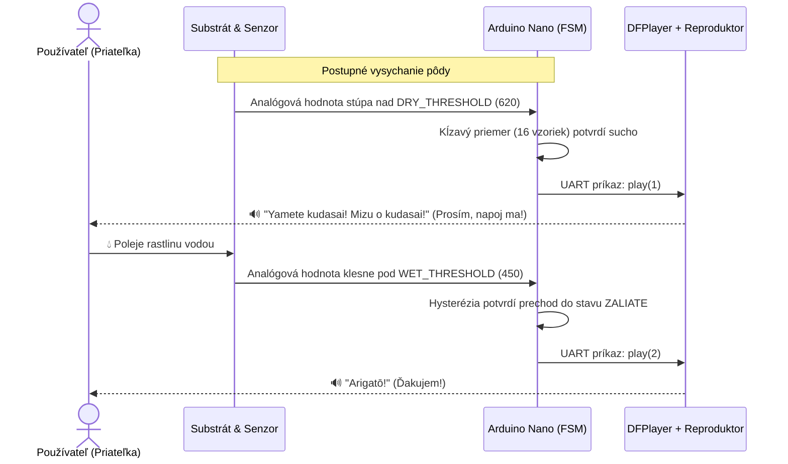

---
# 🧩 Versioning – systém dopĺňa automaticky
fm_version: "1.0.1"

# Dátum buildu – generuje skript
fm_build: "2026-10-05T10:01:14.413939+00:00"

# Poznámka k verzii – voliteľné
fm_version_comment: ""

# 🆔 IDENTITY --------------------------------------------------------

# ID generuje CLI / skript

# Unikátne UUID – generuje skript
guid: "1bd06c9b-b859-4211-b77a-b415c267b891"

# 🧭 CONTEXT ---------------------------------------------------------

# DAO / doména (knife, sdlc, q12, 7ds...) dopĺňa skript
dao: "sthdf"

# Názov zápisu – dopĺňa používateľ
title: "architecture diagram"

# Krátky popis – dopĺňa používateľ (voliteľné)
description: "{{DESCRIPTION}}"

# 👥 AUTHORSHIP ------------------------------------------------------

# Hlavný autor – z globálneho configu
author: "Roman Kazicka"

# Zoznam autorov – generuje skript
authors:
  - "Roman Kazicka"

# 🗂 CLASSIFICATION ---------------------------------------------------

# Nadradená kategória – môže doplniť používateľ
category: ""

# Typ dokumentu (guide, case, tutorial...) – používateľ (voliteľné)
type: ""

# Priorita (low/medium/high) – voliteľné
priority: ""

# Tagy – odporúča sa 2–6 tagov.
# Typy tagov:
#   - rámce: knife, 7ds, sdlc, q12
#   - účel: tutorial, guide, pattern, case-study
#   - téma: git, backup, ai, communication
#   - úroveň: beginner, intermediate, advanced
tags: []

# 🌍 LOCALIZATION -----------------------------------------------------

# Jazyk dokumentu – doplní skript podľa štruktúry
locale: "sk"

# 🕒 LIFECYCLE --------------------------------------------------------

# Dátum vytvorenia – generuje skript
created: "2026-10-05 12:01"

# Dátum poslednej úpravy – dopĺňa človek
modified: "2026-10-05 12:01"

# Stav dokumentu – default "backlog"
status: "backlog"

# Viditeľnosť – default "public"
privacy: "public"

# ⚖ INTELLECTUAL PROPERTY -------------------------------------------

# Držiteľ práv k obsahu – dopĺňa skript
rights_holder_content: "Roman Kazicka"

# Systémový vlastník práv
rights_holder_system: "CAA / KNIFE / LetItGrow"

# Licencia
license: "CC-BY-NC-SA-4.0"

# Disclaimer
disclaimer: "Use at your own risk. Methods provided as-is; participation is voluntary and context-aware."

# Copyright
copyright: "© 2025 Roman Kazicka"

# 🔗 ORIGIN / PROVENANCE ---------------------------------------------

# Repozitár pôvodu
origin_repo: ""

# URL pôvodného repozitára
origin_repo_url: ""

# Commit pôvodu
origin_commit: ""

# Branch pôvodu
origin_branch: ""

# Systém pôvodu (CAA/KNIFE/STHDF…)
origin_system: "CAA"

# Pôvodný autor
origin_author: "Roman Kazicka"

# Importovaný zdroj
origin_imported_from: ""

# Dátum importu
origin_import_date: ""

# 🧱 RESERVED ---------------------------------------------------------

fm_reserved1: ""
fm_reserved2: ""
---

<!-- SDLC_INSTANCE_ID: ST-004-Kozel -->

# 🏗️ Architecture Diagram — OtakuPlanter (PRJ_004)

Architektúra systému **OtakuPlanter** je rozdelená do štyroch spolupracujúcich subsystémov: senzorického, riadiaceho, aktuačného (zvuk/svetlo) a mechanického (dvojkomorové 3D telo).

---

## 1. Blokový diagram systému (Hardware & Subsystem Architecture)

---

## 2. Stavový automat firmvéru (Finite State Machine)

---

## 3. Sekvenčný diagram interakcie s používateľom

---

## 4. Tabuľka prepojenia komponentov (Pinout)

| Komponent | Pin komponentu | Pin Arduino Nano | Signál / Funkcia |
|---|---|---|---|
| **Kapacitný senzor v1.2** | `VCC` | `5V` | Napájanie senzora |
| **Kapacitný senzor v1.2** | `GND` | `GND` | Spoločná zem |
| **Kapacitný senzor v1.2** | `AOUT` | `A0` | Analógové napätie ($1.2\text{ V} - 3.0\text{ V}$) |
| **DFPlayer Mini** | `VCC` | `5V` | Napájanie audia (+ $100\,\mu\text{F}$ kondenzátor) |
| **DFPlayer Mini** | `GND` | `GND` | Spoločná zem |
| **DFPlayer Mini** | `RX` | `D11` (cez $1\text{ k}\Omega$ rezistor) | Príjem príkazov z MCU |
| **DFPlayer Mini** | `TX` | `D10` | Potvrdenie stavu do MCU |
| **DFPlayer Mini** | `SPK_1`, `SPK_2` | Reproduktor $8\,\Omega / 3\text{ W}$ | Diferenciálny výstup zosilňovača |
| **Indikačná LED** | Anóda (`+`) | `D6` (cez $220\,\Omega$ rezistor) | Vizuálna indikácia stavu (oči postavičky) |

---
**Navigation:** [⬆️ Up](./index.md) · [🏠 Home](../index.md)
