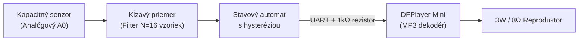

---
# 🧩 Versioning – systém dopĺňa automaticky
fm_version: "1.0.1"

# Dátum buildu – generuje skript
fm_build: "2026-10-05T10:01:14.471849+00:00"

# Poznámka k verzii – voliteľné
fm_version_comment: ""


# 🆔 IDENTITY --------------------------------------------------------

# ID generuje CLI / skript

# Unikátne UUID – generuje skript
guid: "f3fb761f-0b32-498d-8f3c-cb293cb587a9"


# 🧭 CONTEXT ---------------------------------------------------------

# DAO / doména (knife, sdlc, q12, 7ds...) dopĺňa skript
dao: "sthdf"

# Názov zápisu – dopĺňa používateľ
title: "knowledge contribution"

# Krátky popis – dopĺňa používateľ (voliteľné)
description: "{{DESCRIPTION}}"


# 👥 AUTHORSHIP ------------------------------------------------------

# Hlavný autor – z globálneho configu
author: "Roman Kazicka"

# Zoznam autorov – generuje skript
authors:
  - "Roman Kazicka"


# 🗂 CLASSIFICATION ---------------------------------------------------

# Nadradená kategória – môže doplniť používateľ
category: ""

# Typ dokumentu (guide, case, tutorial...) – používateľ (voliteľné)
type: ""

# Priorita (low/medium/high) – voliteľné
priority: ""

# Tagy – odporúča sa 2–6 tagov.
# Typy tagov:
#   - rámce: knife, 7ds, sdlc, q12
#   - účel: tutorial, guide, pattern, case-study
#   - téma: git, backup, ai, communication
#   - úroveň: beginner, intermediate, advanced
tags: []


# 🌍 LOCALIZATION -----------------------------------------------------

# Jazyk dokumentu – doplní skript podľa štruktúry
locale: "sk"


# 🕒 LIFECYCLE --------------------------------------------------------

# Dátum vytvorenia – generuje skript
created: "2026-10-05 12:01"

# Dátum poslednej úpravy – dopĺňa človek
modified: "2026-10-05 12:01"

# Stav dokumentu – default "backlog"
status: "backlog"

# Viditeľnosť – default "public"
privacy: "public"


# ⚖ INTELLECTUAL PROPERTY -------------------------------------------

# Držiteľ práv k obsahu – dopĺňa skript
rights_holder_content: "Roman Kazicka"

# Systémový vlastník práv
rights_holder_system: "CAA / KNIFE / LetItGrow"

# Licencia
license: "CC-BY-NC-SA-4.0"

# Disclaimer
disclaimer: "Use at your own risk. Methods provided as-is; participation is voluntary and context-aware."

# Copyright
copyright: "© 2025 Roman Kazicka"


# 🔗 ORIGIN / PROVENANCE ---------------------------------------------

# Repozitár pôvodu
origin_repo: ""

# URL pôvodného repozitára
origin_repo_url: ""

# Commit pôvodu
origin_commit: ""

# Branch pôvodu
origin_branch: ""

# Systém pôvodu (CAA/KNIFE/STHDF…)
origin_system: "CAA"

# Pôvodný autor
origin_author: "Roman Kazicka"

# Importovaný zdroj
origin_imported_from: ""

# Dátum importu
origin_import_date: ""


# 🧱 RESERVED ---------------------------------------------------------

fm_reserved1: ""
fm_reserved2: ""
---

<!-- SDLC_INSTANCE_ID: ST-004-Kozel -->

# 📚 Knowledge Contribution — Integrácia kapacitného senzora vlhkosti a DFPlayer Mini na Arduine

Toto deliverable je spracované podľa metodiky **KNIFE** (*Knowledge In Friendly Examples*).

---

## 🔖 Názov a stručný popis
- **Téma:** Spoľahlivé meranie pôdnej vlhkosti s filtrovaním šumu, hysteréziou a hlasovou odozvou cez modul DFPlayer Mini na platforme Arduino / ESP32.
- **Prečo je dôležitá:** Začiatočníci v IoT projektoch často používajú lacné odporové sondy, ktoré do niekoľkých týždňov zhrdzavejú, a čítajú surové analógové dáta bez hysterézie, čo spôsobuje neustále spínanie/vypínanie výstupu na hranici prahu.

---

## ⚡ Rýchly návod (Top)

1. Použi **kapacitný senzor v1.2** namiesto odporového (pripoj na `5V`, `GND`, `A0`).
2. Na čítanie použi **kĺzavý priemer** (aspoň 10 vzoriek) na odfiltrovanie šumu.
3. Zaveď **hysteréziu** (dva prahy: `DRY_THRESHOLD` pre spustenie poplachu a `WET_THRESHOLD` pre ukončenie poplachu).
4. **DFPlayer Mini** pripoj cez `SoftwareSerial` (napr. piny `D10`, `D11`) a na `RX` pin DFPlayera vlož **1 kΩ rezistor** (odstráni praskanie v reproduktore).

---

## 🎯 Čo rieši (účel, cieľ)
Pri návrhu smart kvetináčov (ako náš projekt **OtakuPlanter**) vznikajú 3 typické hardvérovo-softvérové problémy:
1. **Elektrochemická korózia:** Bežné vidličkové odporové senzory púšťajú prúd priamo cez vlhkú zeminu, čím dochádza k elektrolýze a zničeniu sondy.
2. **Oscilácia stavu na hrane prahu:** Ak nastavíme jediný prah (napr. `ADC > 600 = sucho`), drobný šum na ADC spôsobí, že hodnota skáče `599 <-> 601` a zvuková hláška sa spúšťa opakovane každú sekundu.
3. **Rušenie na UART linke DFPlayera:** Pri napájaní Arduina aj DFPlayera z rovnakého 5V zdroja vzniká v reproduktore bzučanie a praskanie kvôli rozdielu logických úrovní (5V Arduino vs. 3.3V logika DFPlayera).

---

## 🧩 Ako to rieši (princíp)



- **Kapacitný princíp:** Senzor tvorí dosky kondenzátora izolované nepájivou maskou, pričom okolitá zemina slúži ako dielektrikum. Žiadny kov nie je v priamom kontakte s vodou.
- **Dvojitý prah (Hysterézia):**
  - Pôda vysychá $\rightarrow$ hodnota ADC stúpa. Keď prekročí `DRY_THRESHOLD` (napr. `620`), stav sa prepne na `SMÄDNÝ`.
  - Stav sa vráti na `OK` až vtedy, keď používateľ kvetináč reálne poleje a hodnota klesne pod `WET_THRESHOLD` (napr. `450`).

---

## 🧪 Ako to použiť (aplikácia)

### 1. Zapojenie pinov (Wiring)
| Modul | Pin modulu | Pin Arduino Nano | Poznámka |
|---|---|---|---|
| **Senzor vlhkosti** | `VCC` / `GND` / `AOUT` | `5V` / `GND` / `A0` | Analógový vstup |
| **DFPlayer Mini** | `VCC` / `GND` | `5V` / `GND` | Odporúčaný kondenzátor 100µF na napájaní |
| **DFPlayer Mini** | `RX` | `D11` (cez **1 kΩ** rezistor!) | Prispôsobenie úrovne a eliminácia šumu |
| **DFPlayer Mini** | `TX` | `D10` | Sériová komunikácia |
| **DFPlayer Mini** | `SPK_1`, `SPK_2` | Reproduktor 8Ω / 3W | Priamy výstup zosilňovača |

### 2. Kalibrácia senzora
Pred nasadením odmeraj dve referenčné hodnoty cez Serial Monitor:
- **Senzor na vzduchu (0 % vlhkosť):** napr. `ADC_AIR = 780`
- **Senzor ponorený v pohári vody (100 % vlhkosť):** napr. `ADC_WATER = 340`

### 3. Ukážkový kód s filtrom a hysteréziou
```cpp
const int PIN_SOIL = A0;
const int DRY_THRESHOLD = 620; // Nad touto hodnotou je sucho
const int WET_THRESHOLD = 450; // Pod touto hodnotou je poliate

bool isThirsty = false;

int readFilteredSoil() {
  long sum = 0;
  for (int i = 0; i < 16; i++) {
    sum += analogRead(PIN_SOIL);
    delay(5);
  }
  return (int)(sum / 16);
}

void evaluateState() {
  int raw = readFilteredSoil();
  if (!isThirsty && raw > DRY_THRESHOLD) {
    isThirsty = true;
    // Spusti japonskú hlášku: "Yamete kudasai, mizu o kudasai!" (Track 0001.mp3)
    myDFPlayer.play(1);
  } else if (isThirsty && raw < WET_THRESHOLD) {
    isThirsty = false;
    // Spusti ďakovnú hlášku: "Arigato!" (Track 0002.mp3)
    myDFPlayer.play(2);
  }
}
```

---

## 📜 Detailný článok
Pri práci s modulom **DFPlayer Mini** závisí poradie prehrávaných súborov od štruktúry na MicroSD karte (súborový systém **FAT16** alebo **FAT32**). Najspoľahlivejší spôsob je vytvoriť na karte priečinok `/mp3` a súbory pomenovať štvorciferným prefixom:
- `/mp3/0001.mp3` – Hláška pri suchu
- `/mp3/0002.mp3` – Hláška po zaliatí
- `/mp3/0003.mp3` – Uvítacia znelka pri štarte

Pri kopírovaní na macOS alebo Linuxe systém často vytvára skryté súbory (`.DS_Store`, `._0001.mp3`), ktoré môžu zmiasť interný index DFPlayera. Pred odpojením SD karty je preto vhodné vymazať skryté metadáta príkazom `rm -rf /media/sdcard/._*`.

---

## 💡 Tipy a poznámky
- **Ochrana elektroniky senzora:** Hoci samotná sonda kapacitného senzora je zaliata laminátom, v hornej časti má odkryté SMD súčiastky (časovač NE555). Hrany a vrchnú elektroniku senzora pretav tavnou pištoľou alebo prelakuj bezfarebným lakom na nechty.
- **Odber prúdu pri prehrávaní:** Pri plnej hlasitosti berie DFPlayer špičkovo až `200–300 mA`. Hlasitosť v kóde nastav na rozumnú hodnotu `myDFPlayer.volume(22);` (rozsah je `0–30`).

---

## ✅ Hodnota / Zhrnutie
Tento návod poskytuje okamžite použiteľný vzor pre akýkoľvek študentský IoT projekt na predmete STHDF, ktorý kombinuje analógové senzory a audio výstup bez typických začiatočníckych chýb (zhrdzavený senzor, bzučiaci reproduktor, zacyklené prehrávanie).

---

## 🗂️ Taxonómia KNIFE
- **Kategória:** IoT, Embedded Systems, Hardware Prototyping
- **Typ:** Praktický návod (How-To / Pattern)
- **Tagy:** `arduino`, `dfplayer`, `soil-sensor`, `hysteresis`, `sthdf`, `knife`

## 🌍 Referencie
- [DFRobot Capacitive Soil Moisture Sensor Wiki](https://wiki.dfrobot.com/Capacitive_Soil_Moisture_Sensor_SKU_SEN0193)
- [DFPlayer Mini MP3 Player Datasheet & Wiring Guide](https://wiki.dfrobot.com/DFPlayer_Mini_SKU_DFR0299)

## Navigácia
- [↩️ Späť](../index.md)
