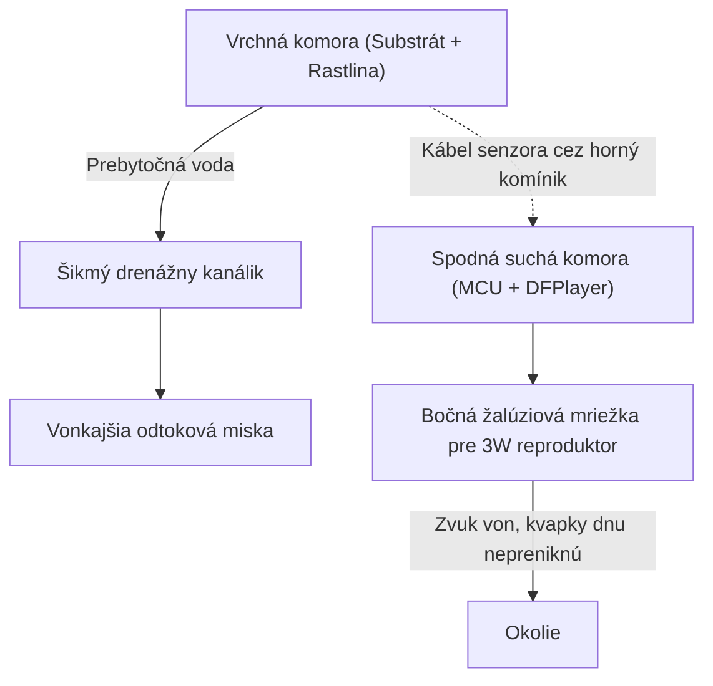

---
# 🧩 Versioning – systém dopĺňa automaticky
fm_version: "1.0.1"

# Dátum buildu – generuje skript
fm_build: "2026-10-05T10:01:19.204948+00:00"

# Poznámka k verzii – voliteľné
fm_version_comment: ""

# 🆔 IDENTITY --------------------------------------------------------

# ID generuje CLI / skript

# Unikátne UUID – generuje skript
guid: "81f78e99-0aea-4d5a-9b5b-f0424730afc8"

# 🧭 CONTEXT ---------------------------------------------------------

# DAO / doména (knife, sdlc, q12, 7ds...) dopĺňa skript
dao: "sthdf"

# Názov zápisu – dopĺňa používateľ
title: "knowledge contribution"

# Krátky popis – dopĺňa používateľ (voliteľné)
description: "{{DESCRIPTION}}"

# 👥 AUTHORSHIP ------------------------------------------------------

# Hlavný autor – z globálneho configu
author: "Roman Kazicka"

# Zoznam autorov – generuje skript
authors:
  - "Roman Kazicka"

# 🗂 CLASSIFICATION ---------------------------------------------------

# Nadradená kategória – môže doplniť používateľ
category: ""

# Typ dokumentu (guide, case, tutorial...) – používateľ (voliteľné)
type: ""

# Priorita (low/medium/high) – voliteľné
priority: ""

# Tagy – odporúča sa 2–6 tagov.
# Typy tagov:
#   - rámce: knife, 7ds, sdlc, q12
#   - účel: tutorial, guide, pattern, case-study
#   - téma: git, backup, ai, communication
#   - úroveň: beginner, intermediate, advanced
tags: []

# 🌍 LOCALIZATION -----------------------------------------------------

# Jazyk dokumentu – doplní skript podľa štruktúry
locale: "sk"

# 🕒 LIFECYCLE --------------------------------------------------------

# Dátum vytvorenia – generuje skript
created: "2026-10-05 12:01"

# Dátum poslednej úpravy – dopĺňa človek
modified: "2026-10-05 12:01"

# Stav dokumentu – default "backlog"
status: "backlog"

# Viditeľnosť – default "public"
privacy: "public"

# ⚖ INTELLECTUAL PROPERTY -------------------------------------------

# Držiteľ práv k obsahu – dopĺňa skript
rights_holder_content: "Roman Kazicka"

# Systémový vlastník práv
rights_holder_system: "CAA / KNIFE / LetItGrow"

# Licencia
license: "CC-BY-NC-SA-4.0"

# Disclaimer
disclaimer: "Use at your own risk. Methods provided as-is; participation is voluntary and context-aware."

# Copyright
copyright: "© 2025 Roman Kazicka"

# 🔗 ORIGIN / PROVENANCE ---------------------------------------------

# Repozitár pôvodu
origin_repo: ""

# URL pôvodného repozitára
origin_repo_url: ""

# Commit pôvodu
origin_commit: ""

# Branch pôvodu
origin_branch: ""

# Systém pôvodu (CAA/KNIFE/STHDF…)
origin_system: "CAA"

# Pôvodný autor
origin_author: "Roman Kazicka"

# Importovaný zdroj
origin_imported_from: ""

# Dátum importu
origin_import_date: ""

# 🧱 RESERVED ---------------------------------------------------------

fm_reserved1: ""
fm_reserved2: ""
---

<!-- SDLC_INSTANCE_ID: ST-013-Strecko -->

# 📚 Knowledge Contribution — Návrh a 3D tlač dvojkomorového vodotesného obalu pre IoT kvetináč

Toto deliverable je spracované podľa metodiky **KNIFE** (*Knowledge In Friendly Examples*).

---

## 🔖 Názov a stručný popis
- **Téma:** Metodika konštrukčného CAD návrhu a nastavenia 3D tlače (FDM) pre zariadenia kombinujúce mokrú zónu (substrát a voda) so suchou zónou (mikrokontrolér, audio a batéria).
- **Prečo je dôležitá:** Bežný 3D výtlačok z PLA alebo PETG nie je prirodzene vodotesný kvôli mikrotrhlinám medzi vrstvami. Pri spojenom návrhu bez oddelenej drenáže hrozí presakovanie vlhkosti a skratovanie elektroniky.

---

## ⚡ Rýchly návod (Top)

1. **Dvojkomorová architektúra:** Navrhni model s fyzickou medzistenou a drenážnym kanálikom, ktorý odvádza prebytočnú vodu do bočnej misky mimo elektroniky.
2. **Slicer nastavenia pre vodotesnosť:**
   - Počet perimetrov (Wall loops): **minimálne 4 až 6** (hrúbka steny $\ge 1.6\text{ mm}$).
   - Flow rate (Extrusion multiplier): zvýš na **103 – 105 %**.
   - Teplota trysky: zvýš o **+5 °C až +10 °C** nad bežný profil pre lepšie spečenie vrstiev.
3. **Káblový prechod:** Senzor veď cez vyvýšený komínik nad úrovňou maximálnej hladiny substrátu (princíp sifónu / hornej priechodky).

---

## 🎯 Čo rieši (účel, cieľ)
Pri digitálnej fabrikácii smart kvetináča (**OtakuPlanter**) vo FabLabe sme narazili na kľúčovú inžiniersku otázku: *Ako spojiť estetický 3D model anime figúrky s mokrou hlinou a citlivou elektronikou (Arduino + DFPlayer + reproduktor) bez rizika vytopenia?*

Rieši tri hlavné riziká:
1. **Kapilárne presakovanie (Weeping):** Voda postupne preniká cez póry medzi vrstvami FDM tlače.
2. **Preliatie kvetináča používateľom:** Nárazové naliatie väčšieho množstva vody.
3. **Akustické utlmenie reproduktora:** Uzavretá elektronika v plaste neprepúšťa zvuk, zatiaľ čo otvorené mriežky na dne môžu nasať rozliatu vodu zo stola.

---

## 🧩 Ako to rieši (princíp)

- **Vertikálna separácia a spádovanie:** Dno kvetináčovej časti je vyspádované pod uhlom $15^\circ$ smerom k zadnému odtokovému kanáliku, takže voda nikdy nestojí priamo nad stropom elektronickej komory.
- **Žalúziová (Louvered) mriežka reproduktora:** Namiesto dier v podlahe sú akustické otvory umiestnené na bočnej stene podstavca so sklonom lamiel $45^\circ$ smerom nadol (zvuk vychádza von, stekajúca voda po povrchu postavičky nevojde dnu).
- **Nožičky podstavca (Standoffs):** Celý podstavec stojí na $4\text{ mm}$ vysokých nožičkách, takže aj keď je na stole mláka vody, elektronika zostáva v suchu.

---

## 🧪 Ako to použiť (aplikácia)

### 1. Odporúčané parametre v PrusaSliceri / Bambu Studiu
| Parameter | Bežná 3D tlač | Vodotesná tlač (OtakuPlanter) | Dôvod |
|---|---|---|---|
| **Materiál** | PLA | **PETG** alebo **PLA+** | PETG má vyššiu chemickú a vlhkostnú odolnosť |
| **Perimetre (Walls)** | 2 | **5** | Eliminuje priame póry cez stenu |
| **Top / Bottom Shell Layers** | 3–4 | **6** | Zabraňuje presakovaniu cez dno nádoby |
| **Seam position (Šev)** | Aligned | **Random / Staggered** | Zamedzí vzniku zvislej oslabenej drážky |
| **Infill Overlap** | 15 % | **25 %** | Lepšie previazanie výplne so stenou |

### 2. Post-processing (Sekundárna hydroizolácia)
Pre 100 % istotu pri dlhodobom kontakte s vlhkou zeminou odporúčame vnútornú stenu kvetináčovej komory:
- Pretrieť tenkou vrstvou **epoxidovej živice** alebo **potravinárskeho silikónu**, prípadne
- Použiť vyberateľnú plastovú vložku (liner cup), ktorá sa dá pri presádzaní kvetu ľahko vybrať a umyť bez manipulácie s elektronikou.

---

## 📜 Detailný článok
Pri úprave existujúceho umeleckého 3D modelu (napr. STL figúrky anime postavičky) v CAD/Mesh softvéri (Blender / Meshmixer / Python `trimesh`) postupujeme metódou **CSG (Constructive Solid Geometry)** – boolovských operácií:
1. **Zjednotenie (Union):** K modelu postavičky pripojíme valcový podstavec s hrúbkou steny $3\text{ mm}$.
2. **Odčítanie vrchnej komory (Difference):** Z hornej časti odčítame zrezaný kužeľ pre substrát.
3. **Odčítanie spodnej komory (Difference):** Zospodu podstavca vyrežeme priestor pre Arduino Nano ($45 \times 18\text{ mm}$), DFPlayer Mini ($20 \times 20\text{ mm}$) a osadenie pre reproduktor ($\varnothing 40\text{ mm}$).
4. **Káblový tunel:** Medzi vrchnou a spodnou komorou vyrežeme vertikálny kanálik ($\varnothing 5\text{ mm}$) pre trojžilový kábel kapacitného senzora, ktorý sa po prevlečení utesní kvapkou tavného lepidla.

---

## 💡 Tipy a poznámky
- **Skúška tesnosti pred osadením elektroniky:** Predtým, než do vytlačeného tela vložíš Arduino a reproduktor, nalej do vrchnej komory vodu zafarbenú potravinárskym farbivom a nechaj ju stáť 12 hodín na papierovej servítke. Ak servítka v suchej komore zostane čistá, model je pripravený na montáž.
- **Servisný prístup:** Spodné veko elektronickej komory neliate na pevno – použi 3 skrutky `M3` (alebo bajonetový uzáver), aby bolo možné kedykoľvek vybrať MicroSD kartu a nahrať nové japonské audio hlášky.

---

## ✅ Hodnota / Zhrnutie
Táto metodika premieňa obyčajnú dekoratívnu 3D figúrku na funkčný, bezpečný a dlhodobo udržateľný mechatronický produkt. Ukazuje praktické prepojenie systémového myslenia (identifikácia rizík a hraničných stavov) s digitálnou fabrikáciou.

---

## 🗂️ Taxonómia KNIFE
- **Kategória:** Digital Fabrication, 3D Printing, Product Design
- **Typ:** Metodický návod (Design Pattern & How-To)
- **Tagy:** `3d-printing`, `cad`, `waterproofing`, `fablab`, `enclosure`, `sthdf`, `knife`

## 🌍 Referencie
- [Prusa Knowledge Base: Watertight 3D Printing](https://help.prusa3d.com/article/watertight-prints_112324)
- [FabLab Bratislava – Technológie 3D tlače](https://www.fablab.sk/)

## Navigácia
- [↩️ Späť](../index.md)
